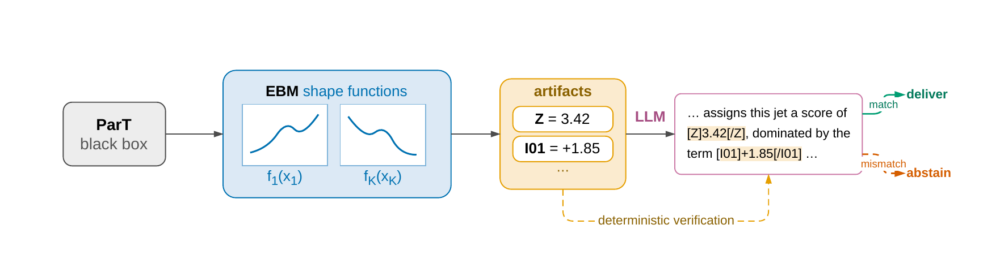

# Generating Reliable XAI Narratives for Deep Classifiers in High-Energy Physics

This repository turns the decision of a jet classifier into a natural-language explanation. The classifier is distilled into an interpretable surrogate over physical observables, an LLM narrates that surrogate under a tagging contract, and a deterministic parser delivers the narrative only if every tag matches.

The same pipeline is applied to two use cases on the same jets: a supervised **top tagger**, and a weakly supervised **anomaly detector** that is never told what it is looking for.

## Pipeline



The classifier is distilled into an EBM surrogate. Each jet's local explanation becomes an artefact, which is formatted into a tagged prompt and passed to an LLM. A deterministic parser checks each tag against the artefact. When it rejects a narrative, the failures go back to the same model for a rewrite, up to five attempts, and the first narrative that passes is delivered. Before any model is called, the system abstains when the surrogate does not reproduce the classifier's decision.

## Case Study

Jets from [TopLandscape](https://zenodo.org/record/2603256): hadronically decaying top jets against a QCD dijet background, anti-kT R = 0.8, pT in [550, 650] GeV, on the official splits of 1.2 M train, 400 k validation and 400 k test jets.

- **Top tagging.** The classifier explained is the [Particle Transformer](https://arxiv.org/abs/2202.03772), pretrained on JetClass and fine-tuned on TopLandscape (seeds 42, 43 and 44; accuracy 0.9435 ± 0.0002, AUC 0.9876 ± 0.0001). The narratives explain seed 42.
- **Anomaly detection.** An IAD classifier is trained on the frozen ParT class token `x_cls` to tell a data sample (QCD plus top jets injected at a signal fraction f) from a pure QCD reference. It learns only which jets are over-represented with respect to the reference, so its narratives may describe how a jet differs from the background but never what produced it. The narratives explain f = 10 %, detector seed 0.

Five LLMs are benchmarked as narrators: Gemini 3.5 Flash, Gemini 3.5 Flash-Lite and DeepSeek Flash through their APIs, and GPT-OSS-120B and Qwen3.8-27B served with vLLM on our own GPUs. The LLM-as-a-judge protocol is being redesigned (see [LLM-as-a-judge](#llm-as-a-judge)).

## Getting Started

The project uses two environments, because the teacher and the rest have incompatible dependency stacks. Everything is run from the repository root. The datasets, checkpoints, teacher logits, feature tables and narrative runs are not tracked here: they are large, and the steps below reproduce them.

```bash
# Observables, surrogate, anomaly detection, narrative, evaluation
conda env create -f environment.yaml
conda activate part-surrogate
export PYTHONPATH="$PWD"

# ParT inference only
python -m venv particle_transformer/.venv
source particle_transformer/.venv/bin/activate
pip install torch weaver-core awkward
```

FastJet and fjcontrib come from conda-forge rather than pip, because the observables are computed through cppyy against the C++ headers and shared libraries, which `fjcontrib_loader.py` resolves under `sys.prefix`.

The vLLM generators need a third environment and GPU nodes; `scripts/setup_vllm.sh` builds it and `scripts/vllm_models.sh` pins the models, their revisions and their tensor parallelism.

### 1) Fine-tuning ParT

`particle_transformer/` vendors the upstream toolkit at commit `2925bdb`: the network definitions, the dataloader, the weaver configs and the train scripts, copied verbatim. Fetch the dataset and fine-tune the teacher there.

```bash
cd particle_transformer
./get_datasets.py TopLandscape -d datasets
./train_TopLandscape.sh ParT-FineTune kin
cd ..
```

The fine-tune starts from upstream's JetClass-pretrained `models/ParT_kin.pt`, so that file has to be in place first. This repository never trains on JetClass itself. On Leonardo, `scripts/slurm/part1_finetune.sbatch` runs the seeded fine-tune.

Then dump the teacher logits. `predict_TopLandscape_logits.py` exists because weaver's own `--predict` applies a softmax before writing and never exports the raw logits, which are the quantity the surrogate is fit to.

```bash
source particle_transformer/.venv/bin/activate
./scripts/infer_TopLandscape_logits.sh ParT-FineTune <checkpoint>   # test split
./scripts/dump_toplandscape_train_val_logits.sh                     # train and validation
```

Both scripts step into `particle_transformer/` on their own, since weaver resolves its configs relative to that tree, and both discover the timestamped run directory rather than assume one.

### 2) Fitting the surrogate

Ten substructure observables, pre-registered in [`surrogate/basis_definitions.md`](surrogate/basis_definitions.md), are computed with FastJet and joined to the ParT logits. Three models are then fit on the logit difference `t(j) = z_top(j) - z_qcd(j)`: Ridge as an additive-linear lower bound, an EBM with no interactions as the interpretable surrogate, and an unconstrained GBDT as an upper bound.

```bash
conda activate part-surrogate
./surrogate/scripts/run_official_top.sh        # features, then Ridge / EBM / GBDT
python -m surrogate.eval_classifier_metrics --predictions surrogate/outputs/top/models/test_predictions.parquet
python -m surrogate.seed_variance              # ADO, and each gap's stability across seeds
./surrogate/scripts/run_label_classifiers.sh   # control: the same models fit on truth labels
```

`surrogate/outputs/top/{features,models}` are symlinks to the current teacher's directory (`top_seed42/`); `surrogate/outputs/README.txt` explains how to switch teacher. Feature tables and fitted models stay local. The numbers they produce are copied into [`surrogate/metrics/top/`](surrogate/metrics/top/) and tracked.

### 3) Anomaly detection

The detector is trained on the frozen ParT class tokens (`scripts/slurm/dump_embeddings.sbatch`), for f = 10 %, 5 % and 1 % and five seeds. The same three surrogates are then fit to its logit. The surrogates are fit on one half of the validation split, selected on the other half (split by jet parity), and reported on test; train is excluded because it is in-sample for the detector.

```bash
sbatch scripts/slurm/anomaly_iad.sbatch        # E1: python -m anomaly.transfer --seed s ..., then anomaly.summarize_seeds
sbatch scripts/slurm/anomaly_surrogate.sbatch  # E2: anomaly.prepare_surrogate_inputs + surrogate.train_surrogates_top per run
python -m anomaly.eval_surrogates              # fidelity at the 10 % working point -> anomaly/outputs/summary_surrogate.json
python -m anomaly.gate                         # abstention gate, calibrated per run -> anomaly/outputs/summary_gate.json
```

## Generating and verifying narratives

The surrogate's decomposition of one jet becomes an artefact. The narrator must wrap every artefact-derived number and every threshold-governed word in a labelled tag. Checking a claim is then a regular expression and an equality test, with no second model in the loop.

Each use case has its own config, which names its inputs, prompt, glossary and generators: `narrative/configs/narrative_top.yaml` and `narrative/configs/narrative_anomaly.yaml`, the second selected by `task: anomaly`.

```bash
# Once per surrogate fit (top tagging)
python -m narrative.stats                      # reference percentiles
python -m narrative.gate_top                   # abstention gate, calibrated on val
python -m narrative.artefact --validate 3000   # offline check, no API key needed

# The jet sample: drawn once, then every model narrates the same jets
python -m narrative.select_top_jets            # top500_jets.json, by decision x correctness
python -m narrative.select_anomaly_jets        # ad100_jets.json, by detector band x true label

# Generation: API generators on the login node, vLLM generators on a GPU node
./scripts/run_generators.sh <block> <jets_file>            # CFG=... for anomaly detection
sbatch --export=ALL,MODEL=qwen3.8-27b,CFG=<config>,BLOCK=<block>,JETS=<jets_file> \
    scripts/slurm/vllm_generate.sbatch

# Pass rates, after the first attempt and after refinement
python -m narrative.blocks_report --blocks v17 --attempt first
python -m narrative.blocks_report --config narrative/configs/narrative_anomaly.yaml --blocks ad100 --attempt final
```

Both use cases use the same abstention scheme. The system abstains when the surrogate takes the other decision. It narrates with a caveat when the surrogate agrees but places the jet far from where the classifier does: for top tagging, more than X percentile points apart in rank, with X calibrated on val; for anomaly detection, rarities more than ten times apart that fall in different bands. Everything else is narrated in full.

The jet samples are stratified so that mistakes are represented. Top tagging is drawn by decision × correctness. Anomaly detection is drawn by detector band × true label, which covers false alarms and missed tops. The truth label is used only for the design and the analysis: no artefact carries it.

`blocks_report.py` re-verifies every narrative rather than trusting the verdict each run recorded, since a rate is only a rate if it comes from one contract. With `--attempt final` it also reports how many attempts each delivered narrative took.

| `--backend` | protocol | credential |
|---|---|---|
| `aistudio` | google-genai | `GOOGLE_API_KEY` |
| `vertex` | google-genai | application default credentials |
| `deepseek` | OpenAI-compatible | `DEEPSEEK_API_KEY` |
| `groq` | OpenAI-compatible | `GROQ_API_KEY` |
| `vllm` | OpenAI-compatible, served by us on Leonardo | none (`VLLM_BASE_URL`, default `http://localhost:8000/v1`) |

## LLM-as-a-judge

What verification cannot settle was scored 0 to 3 on three dimensions by Claude Sonnet 5 and, on a twenty-item subsample, by two human annotators. Both saw the narrative alone, without the artefact.

```bash
./run_judges.sh                                # scores a block, resumable
python -m evaluation.judge_report              # scored CSVs into evaluation/results/
python -m evaluation.judge_report --by-model   # mean per generator, --latex for the table body
python -m evaluation.agreement                 # human and judge agreement, --latex
```

`evaluation/annotation_set/` holds only what defines the set: the twenty items as handed out, and `KEY.csv`, the provenance the annotators never saw. Everything a run produced is in `evaluation/results/`.

**This protocol is being redesigned.** On the v17 narratives the judges saturate: 87–100 % of their scores are 3, and narratives that fail verification score at most 0.22 points lower than those that pass. They also agree poorly with the annotators (κ_w 0.06–0.25), and none of them recovers any of the annotators' negatives. The redesign adds a physical-correctness criterion shared by judge and annotators, and tests pairwise comparison, anchored rubrics and binary checklists against the saturation.

## Results

### Top tagging

**Surrogate fidelity** on the test set, for the seed-42 teacher. ADO is average decision ordering; the teacher's is measured against the physical truth ordering rather than against itself. The EBM numbers are stable across five EBM seeds to the fourth decimal.

| model | R² | ADO | decision agreement | AUC |
|---|---|---|---|---|
| Ridge | 0.871 | 0.960 | 0.922 | 0.957 |
| **EBM (ours)** | **0.936** | **0.980** | **0.942** | **0.976** |
| GBDT | 0.956 | 0.985 | 0.955 | 0.980 |
| ParT (teacher) | | 0.988 | | 0.988 |

**Delivery under verification**, v17: the same 100 random test jets for every model, 83 narrated and 17 withheld by the residual gate used at the time. `TOTAL` is the strict conjunction of `Faith` (every tagged number matches), `Comp` (all tags present), `Form` (no malformed tag), `NoBare` (no digit outside a tag) and `Read` (every tagged word is the one its number implies). `attempts` is the mean number of attempts over the narratives delivered within five.

| model | TOTAL, first attempt | TOTAL, after refinement | attempts |
|---|---|---|---|
| Gemini 3.5 Flash | 0.88 | **1.00** | 1.12 |
| Gemini 3.5 Flash-Lite | 0.52 | 0.93 | 1.56 |
| DeepSeek Flash | 0.93 | **1.00** | 1.07 |
| GPT-OSS 120B | 0.07 | 0.78 | 2.18 |
| Qwen3.8 27B | 0.45 | 0.84 | 1.61 |

Since v17 the top-tagging gate works on decisions and ranks (`narrative/gate_top.py`). On test it narrates 68 % of jets in full and 26 % with a caveat, and withholds 6 %. The residual gate it replaces withheld 21 %, almost half of them jets on which tagger and surrogate were both confident and agreed.

### Anomaly detection

**Detector** (E1), top-jet efficiency at 10 % QCD background efficiency, mean ± sd over five seeds: 0.954 ± 0.005 at f = 10 %, 0.933 ± 0.013 at 5 % and 0.862 ± 0.061 at 1 %. For reference, a supervised classifier on the same latent reaches 0.972 and a soft-drop-mass cut 0.669.

**Surrogate fidelity** on the detector logit (E2), f = 10 %, test set, mean over five detector seeds. Decision agreement is at the 10 % working point, with the surrogate's threshold matched by quantile.

| model | R² | ADO | decision agreement | AUC |
|---|---|---|---|---|
| Ridge | 0.615 | 0.918 | 0.829 | 0.919 |
| **EBM (ours)** | **0.761** | **0.948** | **0.898** | **0.949** |
| GBDT | 0.835 | 0.968 | 0.942 | 0.968 |
| IAD (detector) | | 0.974 | | 0.974 |

The EBM's explanation is not dominated by the mass: its leading terms are n_const, m, C2, N3 and tau32. Across detector seeds, 91 % of jets keep the same leading observable.

**Delivery under verification**, ad100: 100 test jets stratified by detector band and true label, 82 narrated, 18 withheld. `Ident` adds a check that no particle, process or signal is named, and all five models score it 1.00. What GPT-OSS 120B still fails after refinement is mostly digits outside a tag.

| model | TOTAL, first attempt | TOTAL, after refinement | attempts |
|---|---|---|---|
| Gemini 3.5 Flash | 0.88 | **1.00** | 1.12 |
| Gemini 3.5 Flash-Lite | 0.55 | 0.95 | 1.51 |
| DeepSeek Flash | 0.84 | **1.00** | 1.16 |
| GPT-OSS 120B | 0.15 | 0.82 | 2.19 |
| Qwen3.8 27B | 0.74 | **1.00** | 1.26 |

## Citation

H. Qu, C. Li and S. Qian, *Particle Transformer for Jet Tagging*, ICML 2022, PMLR **162** (2022) 18281. [arXiv:2202.03772](https://arxiv.org/abs/2202.03772)

H. Qu, C. Li and S. Qian, *JetClass: A Large-Scale Dataset for Deep Learning in Jet Physics*, Zenodo (2022). [doi:10.5281/zenodo.6601445](https://doi.org/10.5281/zenodo.6601445)

G. Kasieczka, T. Plehn, J. Thompson and M. Russell, *Top Quark Tagging Reference Dataset*, Zenodo (2019). [doi:10.5281/zenodo.2603256](https://doi.org/10.5281/zenodo.2603256)

G. Kasieczka, T. Plehn, A. Butter et al., *The Machine Learning Landscape of Top Taggers*, SciPost Phys. **7** (2019) 014. [arXiv:1902.09914](https://arxiv.org/abs/1902.09914)

Y. Lou, R. Caruana and J. Gehrke, *Intelligible Models for Classification and Regression*, KDD 2012, 150. [doi:10.1145/2339530.2339556](https://doi.org/10.1145/2339530.2339556)

H. Nori, S. Jenkins, P. Koch and R. Caruana, *InterpretML: A Unified Framework for Machine Learning Interpretability*, (2019). [arXiv:1909.09223](https://arxiv.org/abs/1909.09223)

M. Cacciari, G. P. Salam and G. Soyez, *FastJet User Manual*, Eur. Phys. J. C **72** (2012) 1896. [arXiv:1111.6097](https://arxiv.org/abs/1111.6097)

[fastjet-contrib](https://fastjet.hepforge.org/contrib/) and [hqucms/weaver-core](https://github.com/hqucms/weaver-core)
